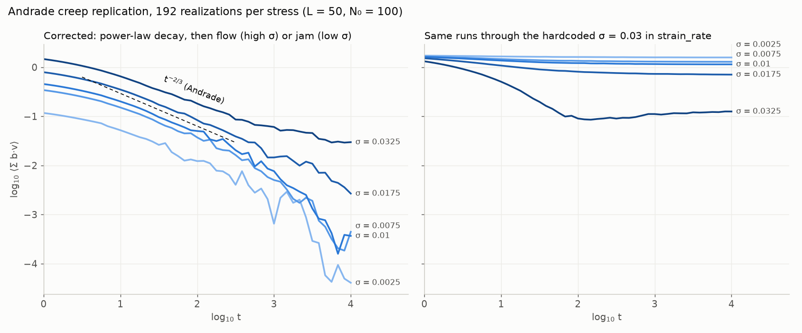
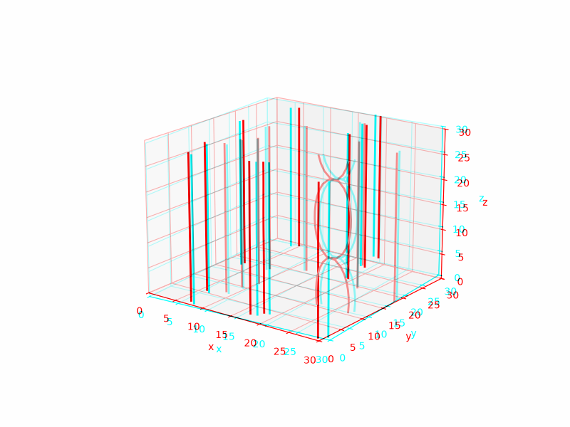

# dislocation

2D discrete dislocation dynamics, trying to reproduce Miguel, Vespignani, Zaiser & Zapperi,
*Dislocation jamming and Andrade creep* (PRL 89, 165501, 2002; [cond-mat/0205217](https://arxiv.org/abs/cond-mat/0205217)).
Edge dislocations glide (overdamped) on parallel slip planes in a box periodic in x; the
question is whether the mean strain rate decays as Andrade creep, dγ/dt ~ t^(-2/3), before
the system either flows (high stress) or jams (low stress).



## What's here

| File | What it is |
|---|---|
| `volterra.py`, `replicating.py`, `dimensionless.py` | The original marimo notebooks, oldest to newest. Left as they were. |
| `dislocation_notes/` | Whiteboard photos: nondimensionalization and the periodic image sum. |
| `corrected.py` | A marimo notebook with the fixed simulation, an ensemble you can run from the UI, the Fig. 1 comparison, and the stress-field art. |
| `replication/` | The same code as plain scripts, for running big ensembles off the notebook. |
| `marvelous_3d.py` | The model in 3D: wiggly dislocation lines instead of points, plus red/cyan anaglyphs and a wigglegram. Written in the style of `dimensionless.py`. |
| `figures/` | Output: the Fig. 1 comparison above, a stress-field banner, and the 3D anaglyph and wigglegram. |

## What was wrong in `dimensionless.py`

`python replication/check_original_bugs.py` reproduces the first two by calling the
notebook's own functions.

1. **Annihilated dislocations keep pushing.** The `elim_mult` mask in
   `sigma_s_analytic_sum` broadcasts across columns (targets) instead of rows (sources), so a
   dead dislocation still exerts its full stress on everything else, and only the stress *on*
   it gets zeroed. In the check, a dead dislocation puts 0.33 Db/y_e on its neighbour.
2. **`strain_rate` hardcodes `sigma_ext=0.03`.** Every curve gets 0.03·N added to Σ b·v
   whatever the applied stress, which flattens the decay and hides the stress dependence. At
   σ = 0.0025 the check gives −0.21 for the true value and +0.34 reported. The right-hand
   panel of the figure is this bug applied to correct runs.
3. **Annihilation happens inside the `solve_ivp` right-hand side**, so it also fires on
   trial stages and rejected steps that the integrator later throws away.
4. **Too small and too short:** N = 50 and t up to 10³, against the paper's N₀ = 400 in
   L = 100 y_e and t up to 10⁵.

Smaller things: the annihilation distance isn't measured periodically in x, plots use the
step index as time, and sampling is linear where the decay is a power law.

## What the corrected code does

- Glide velocity v_n = b_n (Σ_m b_m σ_s(r_nm) + σ) with the image sum over x in closed form,
  checked against a brute-force sum to ~7 digits. Units are the paper's: lengths in y_e,
  stress in Db/y_e, time in y_e²/(χDb³).
- Hand-written adaptive Dormand–Prince RK45. Annihilation (opposite signs closer than y_e,
  periodic distance) is checked only between accepted steps, and a dislocation may glide at
  most 0.2 y_e per step so a pair can't jump past each other between checks.
- The pairwise kernel is numba-compiled and evaluates each pair once (σ_s is odd).
- The system is stiff, because stacked same-sign dislocations sit in steep wells; that caps
  the explicit step near dt ≈ 0.3 and is why long runs are slow. An implicit Rosenbrock
  method was tried and was slower still.

## Results so far

192 realizations per stress at L = 50, N₀ = 100 (the paper's initial density at a quarter of
the area), relaxed at σ = 0 for t = 1000, then loaded to t = 10⁴:

- Power-law decay at every stress, slopes about −0.54 to −0.63 (the paper fits −0.69).
- High stress crosses over to steady flow and low stress jams, as in the paper.
- After relaxation the density is about 2.3% against the paper's ~1%, so the jamming stress
  σ_c comes out higher. Open questions: whether that's the smaller box, the shorter
  relaxation, or a difference in the annihilation rule.

## The 3D version (`marvelous_3d.py`)



Each dislocation is a line on its own glide plane, periodic in z, made of nodes that glide
perpendicular to the line within the plane. The stress on a node is the 2D periodic sum, treating
every other line as straight at its average x, plus a correction for the wiggles. The correction is
the nonsingular Peach–Koehler integral (Cai et al. 2006, core radius a = 0.2 y_e) over the real line
minus the straightened one, integrated exactly along each segment. A line's own field is replaced by
line tension, with the same core radius as its inner cutoff. Opposite-sign lines on planes closer
than y_e annihilate whole as soon as any part of them touches. Checks in the notebook:

- The stress formula matches the textbook edge, screw and mixed straight-line fields.
- The segment integrals match brute-force quadrature.
- Straight lines move exactly like the 2D model. With a = 0 a full relax-and-load run matches
  `replication/sim.py` to 2.5×10⁻⁴.
- A lone wiggle decays at the line-tension rate.

So far, from single runs only: almost every wiggle relaxes away, but same-sign lines on nearby planes
that cross get locked into a crossed, junction-like pair (the bent pair in the picture). One run each
to t = 1000 at σ = 0.0125 took about 6 minutes for wiggly lines and 45 s for straight ones. Both jam.
Nothing here says yet whether the 3D version changes the exponent.

Two things the model doesn't do: crossing same-sign lines never reconnect, and lines never
cross-slip off their glide planes.

## Running it

Notebook (uv reads the dependencies from the file header):

```
uvx marimo edit --sandbox corrected.py
uvx marimo edit --sandbox marvelous_3d.py
```

Scripts (needs numpy, numba, matplotlib):

```
cd replication
python check_original_bugs.py
python ensemble.py probe                  # one seed, prints timing
python ensemble.py 192 12 ens.pkl         # seeds, processes, output
python fig1.py ens.pkl fig1.png
python art_data.py 6 art.pkl && python art.py art.pkl out/
```

One seed (relaxation plus seven stresses) took between about 8 and 40 minutes on one core
in our run, so the full ensemble is a job for a multi-core machine.
